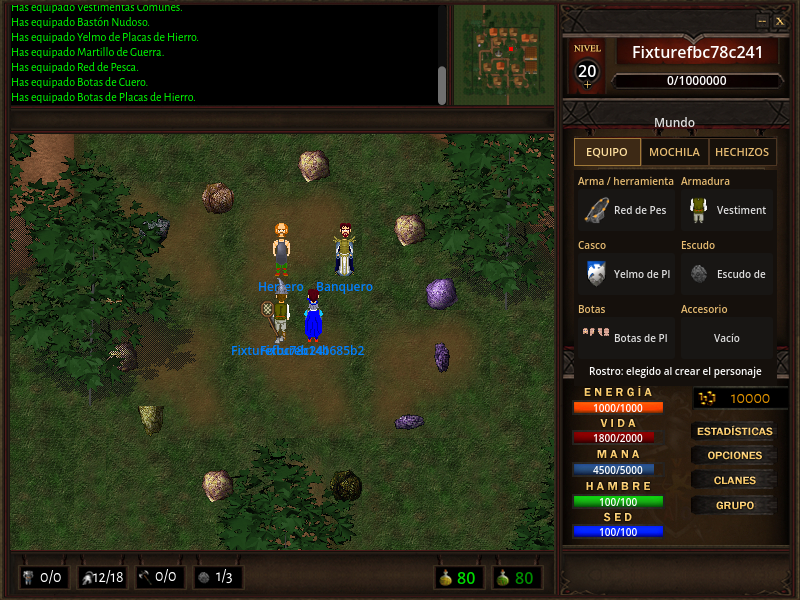
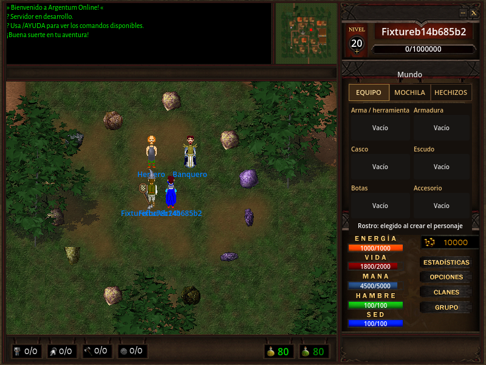

# Objetos individuales y equipo — 23 de octubre de 2026

Implementa servidor #565–#570 y cliente #179, #181, #213–#216, #233 y #239.
Los PR de base son servidor #598 y cliente #238. Ambos extremos conservan
`1.0.0rc6`; el contrato coordinado es `pyao-1.0-draft.2`.

## Ejecución final

Servidor `4b244a4ec51f5db0897dd88367ff17d166a52251` instalado desde wheel; cliente
`35321fa58909b177bcf05ba40c2d416dc7c15482` exportado con Godot 4.7.2 oficial, desde checkout
limpio. [El resultado](native-result.json) conserva hashes del wheel, ejecutable,
entrada y procedencia. Redis 8.10.2/AOF es un sandbox propio de la prueba.

Aprobaron [14 etapas](scenarios.json): equipo de ambos personajes y sus cuatro
orientaciones, cinco botas, cara base constante, reconexión, portales,
desequipamiento, inspección de ejemplares distintos, banco/suelo, intercambio
bidireccional del mismo ejemplar gastado, vencimiento equipado, combate y
recolección de madera, minerales y pesca. Las ranuras de EQUIPO se operan con
sus botones y selector integrado; no se acredita un cambio sólo por el icono.
Ambos clientes usaron PulseAudio. La observación posterior fue de 17/16 s;
es una regresión funcional y no una nueva aceptación R10 de treinta minutos.

## Conservación y carga real

[Redis](redis-items.json) acredita doce depósitos concurrentes sobre un mismo
objeto, pérdida del ACK después del EXEC, replay sin doble gasto, dos atacantes
sobre un blanco, liquidación concurrente de muerte y reinicio AOF. Se conserva
identidad, fechas y usos del equipo caído. La limpieza retira como máximo 64
vencimientos por ciclo, conserva referencias vivas y no borra ante suelo ilegible.

Para 100.000 objetos en 5.000 contenedores, la migración midió
10.402 s, 4.7205 s de
CPU del migrador y 0.7730 s de CPU de Redis.
El uso de memoria pasó de 3.87 a
44.73 MB al incorporar identidad y estado por ejemplar.
El AOF acumulado registró 3029565 bytes antes y
56610852 después. Estos valores incluyen el historial del
log durante el ensayo.

Sobre treinta lecturas de veinte slots, el p95 local fue
0.1212 ms para el hash de existencias y
1.5373 ms para la lectura
actual, que incluye metadatos, condición, estadísticas y validación coherente.
El JSON también conserva las medidas de 1.000 objetos. Son mediciones de este
entorno de prueba; el script conserva el procedimiento reproducible.

## Recursos, audio y controles

[La comprobación confinada](snap-resources-audio.json) ejecutó el candidato
final dentro del Snap instalado, desde su directorio de revisión aislado.
Verificó recursos obligatorios, TLS/certificado bajo contraseña, las seis ranuras,
rechazos de tipo y selección obsoleta, y salida PulseAudio de introducción y dos
pistas de mapa con muestras y RMS no nulos. Fue una ejecución sin ventana.
El ejecutable gráfico se verificó por separado en las dos ventanas de arriba.
Esta comprobación no instaló ni publicó una nueva revisión del Snap.

[Los controles](verification.json) registran 4.208 pruebas completas del servidor,
cuatro omitidas y 80,82 % de cobertura. El árbol `src` permanece idéntico al de
esa ejecución; se agregaron después tres casos de rostro y aprobaron los catorce
casos de apariencia. Pasaron Ruff, formato, mypy, herramientas, inventario de
protocolo, 156 pruebas de herramientas del cliente y 72 subcasos, escenas Godot
y 386 referencias gráficas, incluidas las cinco botas.

## Reproducir

Desde el servidor:

```sh
uv run python tools/item_instances_smoke.py --output artifacts/items
uv run pytest -q -n 4 --cov=src --cov-fail-under=79 tests
```

Desde el cliente, con el wheel y la exportación R10 de los commits indicados:

```sh
GODOT_BIN=/ruta/a/Godot_v4.7.2-stable_linux.x86_64 tools/smoke-godot.sh
python tools/integration-world.py --server-project ../pyao-server --wheel /ruta/servidor.whl --godot /ruta/godot --client-executable /ruta/pyao-client-r10.x86_64 --scenario durable-items --seconds 15 --client-audio PulseAudio --output /ruta/evidencia
```

Los intentos interrumpidos o fallidos del desarrollo permanecen fuera de esta
carpeta y no se usan como aprobación. Los commits posteriores que agregan esta
evidencia conservan el código de runtime verificado.




