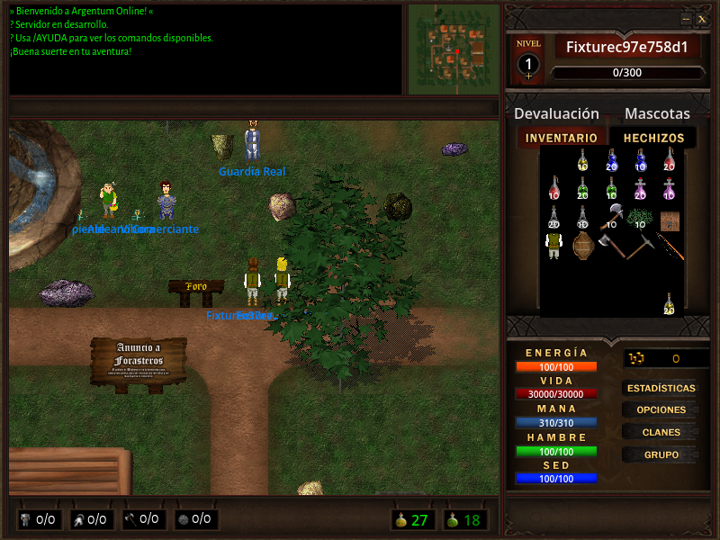
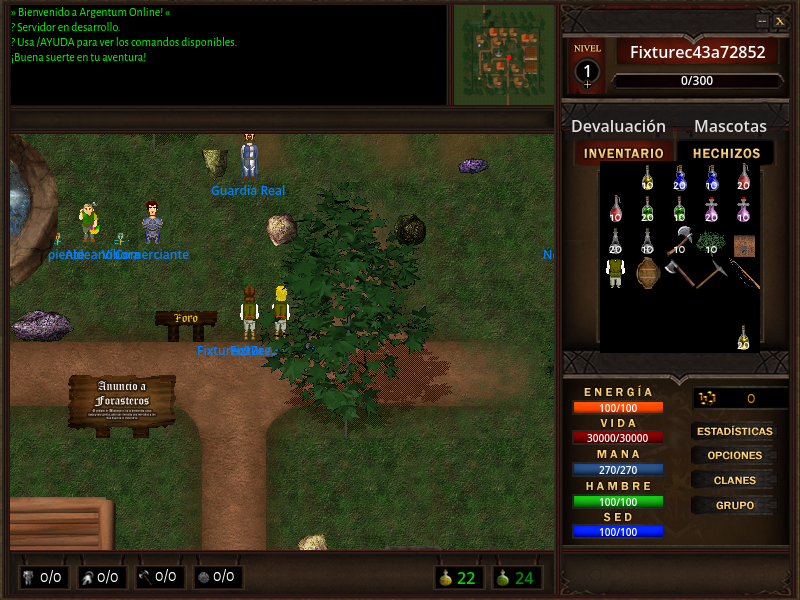
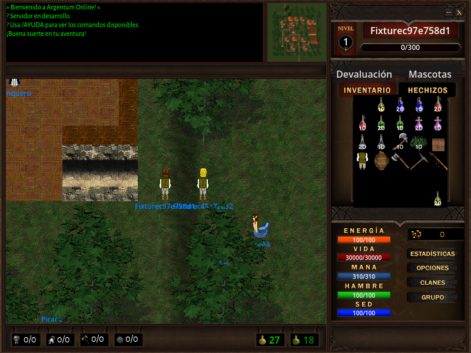
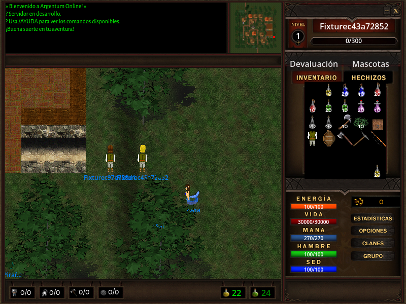

# NPC: auditoría #307

Auditoría de código y runtime sobre el servidor `5015e3b` y cliente `f19d1831`,
con el nuevo harness de diagnóstico. Se ejecutó desde fuentes con Redis 8.10.2
descartable y Godot 4.7.2, sin datos de jugadores reales ni construcción de
artefactos de distribución.

La rama del cliente incluye además la corrección de posición #137, encontrada
al repetir la auditoría. Un paquete de coordenadas repetidas desplazaba al NPC
una casilla al sur; las correcciones grandes se reducían a un único paso. La
regresión falla con el handler original y pasa con la corrección. Las posiciones
se comparan dentro del rango real de actualización del servidor; fuera de él se
conserva la última posición recibida, sin omitir controles de identidad/apariencia.

Se cargaron **290 mapas y 1602 NPC fijos**. Hay **190 mapas sin generación de NPC
configurada**; esto es una observación explícita, no un error automático.
El reinicio con AOF conservó la población fija y la mascota de control, sin
duplicaciones. Dos receptores recibieron los mismos paquetes de creación.

La muestra gráfica con dos clientes pasó las cinco comprobaciones específicas:
NPC amistosos/hostiles autoritativos, reconexión, comercio, transición de mapa
sin NPC anteriores y criatura hostil visible. Duró unos 50 segundos de acciones;
el período final de observación fue de 13 segundos por cliente. No es la
campaña prolongada de jugabilidad, que quedó pendiente por decisión del usuario.

## Discrepancias y trabajo separado

- [Servidor #311](https://github.com/cavazquez/pyao-server/issues/311): ninguna de
  las 336 plantillas conserva configuración de voces. Hay 55 diferencias con
  los Snd1/Snd2/Snd3 históricos; los IDs propios deben revisarse antes de copiar
  voces. Los controles de envío/reproducción funcionan.
- [Cliente #136](https://github.com/cavazquez/ArgentumOnlineGodot/issues/136):
  falta el WAV 174 de la referencia histórica, hoy oculto por las voces perdidas.
- [Servidor #312](https://github.com/cavazquez/pyao-server/issues/312): 12 spawns
  sobre tiles bloqueados. Otros tres puntos no tienen vecino cardinal caminable
  y requieren revisar alcance de interacción o excepciones intencionales.
- [Servidor #313](https://github.com/cavazquez/pyao-server/issues/313): seis
  orientaciones son ignoradas porque el loader lee `heading` y los datos usan
  `direction`.
- [Servidor #314](https://github.com/cavazquez/pyao-server/issues/314): las dos
  entradas concurrentes duplican los cupos de las cinco zonas. Esperado/observado:
  mapa1 5/10 y 3/6; mapa46 2/4; mapa259 8/16 y 3/6. Las zonas superpuestas del
  mapa259 se contabilizaron por origen independiente.
- [Servidor #315](https://github.com/cavazquez/pyao-server/issues/315): 33
  plantillas declaran reaparición, pero ninguna instancia normal recibe un timer
  positivo. Un control separado con timer explícito sí muere, se retira en ambos
  receptores y reaparece; no sustituye la política que falta en el catálogo.
- [Servidor #316](https://github.com/cavazquez/pyao-server/issues/316): la voz de
  daño Snd2 está conectada al golpe físico y falta en el camino de daño mágico.
- [Servidor #317](https://github.com/cavazquez/pyao-server/issues/317): 30
  instancias identificadas como guardias por sus datos no tienen un rol explícito
  de defensa conectado. Ser amistoso y atacable no define a quién deben atacar.
- [Cliente #137](https://github.com/cavazquez/ArgentumOnlineGodot/issues/137):
  posición remota repetida y correcciones de varios tiles. Corregido y probado
  en la rama del cliente; se cerrará al fusionar su PR.

Los cambios de balance, distribución y contenido se dejan en esas tareas; la
auditoría conserva el mundo que encuentra y devuelve código 1 por sus hallazgos.

## Evidencia

- [Informe por mapa](maps.json): esperado/observado con instancias, rol, posición,
  cuerpo/cabeza, flags, voces y discrepancias de los 290 mapas.
- [Resumen y hashes](summary.json): contadores, reinicio, controles y procedencia.
- [Reproducción y alcance de las comprobaciones](../../operations/npc-audit.md).

Cliente 1, habitantes de la ciudad:

Cliente 2, los mismos habitantes:

Criaturas hostiles en los dos clientes (los árboles ocluyen parte del sprite):

