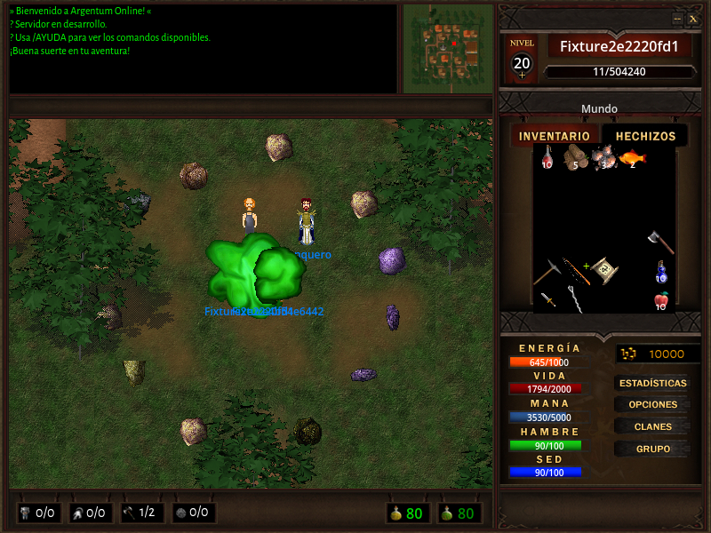
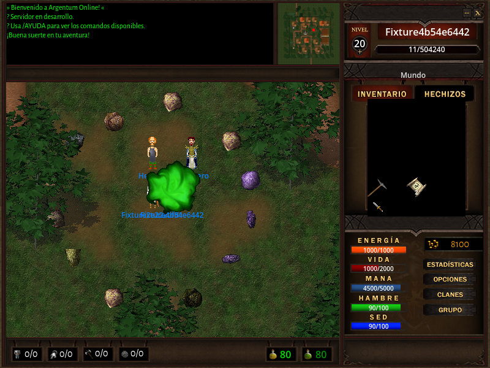

# Auditoría cruzada de paquetes — #583

Esta auditoría identifica cobertura y ausencias. No implementa los opcodes históricos
por el hecho de que figuren en un enum ni sustituye la validación de entradas de #582.

El inventario generado comprende los 251 IDs de las dos direcciones del contrato,
los 146 subcomandos GM y 24 subtipos MultiMessage originales y las acciones JSON de
SKILL_ACTION/WORLD_ACTION, con sus campos y requisitos de capacidad. Para cada ID
registra serializador, recepción/dispatch, consumidor, llamadas, referencias a pruebas,
prioridad, impacto y reproducción conocida. Los campos vacíos de un ID no soportado
no se interpretan como un mensaje válido sin payload.

## Fuentes y reproducción

La línea base del servidor es `9dd5467707118905e60720a897a4a4089fd3d2d4` y la del cliente
`42398cd55dc4843d8ea2830d4dcf7003f62e2475`. Son los commits del código de juego que se
auditó y probó; el commit que añade la herramienta es posterior. Los hashes de los
archivos de runtime permiten comprobar que la muestra sigue correspondiendo al código.

La referencia original es Comunidad-Winter/Argentum-Online, rama 0.13.3, commit
`928f826cd459f727e0c8ea134327bcf55711d573`. `original.json` registra rutas, objetos Git,
SHA256, nombres, IDs, operaciones de lectura/escritura y líneas. Se extrajeron hechos,
no se incorporó código VB6. El material local de `clientes/` tiene diferencias respecto
a esta revisión pública; no se le atribuye falsamente el commit del repositorio PyAO.

Con ambos checkouts, ejecutar desde el servidor:

```sh
python3 tools/analysis/protocol_inventory.py --client ../ArgentumOnlineGodot --check
python3 -m unittest discover -s tools/tests -p test_protocol_inventory.py -v
```

Para una actualización revisada, ejecutar el primer comando sin `--check`. Revisar
`decisions.json`, `inventory.json` e `inventory.md`; no aceptar un diff generado sin
examinar nuevos faltantes. CI ejecuta el mismo control en ambos repositorios, con la
contraparte fijada por commit. No instala el servidor, Redis o Godot para el chequeo.

Para regenerar la referencia, obtener los cuatro archivos de `original.json` en su
commit exacto y ejecutar `extract_ao_protocol.py` con `--reference`, `--origin`,
`--catalog src/network/protocol/chat_commands.json` y `--output`. Los SHA256 deben
coincidir. La herramienta no acepta archivos locales parecidos como sustitutos.

## Cómo interpretar los estados

- `operational_end_to_end`: una muestra con dos clientes nativos confirmó el efecto
  señalado. No acredita todas las variantes, rechazos ni plataformas.
- `wired_not_exercised`: se encontraron extremos y rutas; todavía no se acredita
  una prueba dinámica completa de ese paquete.
- `negotiated_extension`: mensaje/acción propio, habilitado por capacidad. Su
  resultado dinámico se declara por separado.
- `partially_implemented`: existe una parte operativa y una divergencia concreta.
- `emitter_without_receiver` / `receiver_without_emitter`: falta uno de los extremos
  o su habilitación efectiva; no cuentan como funcionalidad implementada.
- `stub_or_noop`: hay una rama o clase que no produce un efecto.
- `declared_unused`: declaración histórica sin ruta habilitada acreditada.
- `replaced_by_other_transport`: función adaptada a TALK o a una extensión propia;
  no hace falta restaurar el opcode antiguo. Los cambios de semántica se explican.
- `retired_not_desired`: ID que no se ofrece en el diseño actual, con motivo explícito.

`binary_support`, `gameplay_support` y `ui_support` son dimensiones distintas.
Encontrar un lector, una llamada o el nombre de un test no prueba por sí solo que
el mensaje llegue al usuario. Las referencias a tests son un índice, no un resultado
de ejecución. Las operaciones primitivas y los campos históricos con control de flujo
no se presentan como esquemas completos; los formatos compuestos se señalan para prueba.

## Hallazgos y orden propuesto

1. **P1 — Formato alternativo de COMMERCE_INIT:** el constructor antiguo produce
   cuatro bytes (`07010000`) para un mensaje de un byte. La ruta activa usa el
   formato correcto. Reproducción en `commerce-init-layout.json`. Seguir en [#588](https://github.com/cavazquez/pyao-server/issues/588).
2. **P2 — Señal de party sin receptor:** el servidor envía SHOW_PARTY_FORM (99), que
   el dispatcher no procesa. GRUPO y las parties sí funcionan con el estado actual.
   Retirar o definir un efecto real: [#589](https://github.com/cavazquez/pyao-server/issues/589).
3. **P2 — Contrato desactualizado:** EXPANSION=1024 no figura en mask_bits, el plazo
   declarado de negociación difiere de Godot y compatibility sigue indicando
   implementaciones pendientes. BANK_OK (85) está marcado supported sin emisor y
   con consumidor `pass`: [#590](https://github.com/cavazquez/pyao-server/issues/590).
4. **P2 — Comercio antiguo duplicado:** hay handlers sin writers y mensajes con
   consumidores vacíos mientras el intercambio real usa TRADE_ACTION/TRADE_STATE.
   Consolidar sin romper cancelación/cierre: [#591](https://github.com/cavazquez/pyao-server/issues/591).
5. **P2 — Reordenar bóveda:** no equivale a depositar/extraer. Servidor [#592](https://github.com/cavazquez/pyao-server/issues/592)
   y cliente [#234](https://github.com/cavazquez/ArgentumOnlineGodot/issues/234), en ese orden.
6. **P2 — Editar ficha de clan:** consultar clan o votar no acredita editar códice,
   noticias/sitio. Servidor [#593](https://github.com/cavazquez/pyao-server/issues/593)
   y cliente [#235](https://github.com/cavazquez/ArgentumOnlineGodot/issues/235), en ese orden.

La música conserva su validación pendiente en cliente #215. Las pruebas negativas
del protocolo continúan en #582. El seguro específico de resurrección, reputación
VB6, macros automáticas, foros de mapa y ItemUpgrade no se habilitan durante esta
auditoría: son decisiones de producto pendientes, distintas de los transportes propios.
La ampliación dinámica de inventario no se ofrece: el inventario actual tiene 30 slots.

## Muestra representativa

El 22 de octubre de 2026 se ejecutaron dos clientes nativos RC6 reales, con TLS,
PulseAudio y Redis 8.10.2 aislado contra el servidor fuente. Aprobaron los 22 recorridos
del smoke R10: alta/ciudades, inventario, banco, comercio, chat, party, combate,
hechizos, meditación, habilidades, mascotas, recolección y reconexión. La observación
posterior duró 10/11 segundos: **no es una nueva aceptación prolongada de 30 minutos**.
No se construyeron ni publicaron nuevos binarios ni Snaps para esta auditoría.

`representative-result.json`, `representative-scenarios.json` y `representative.json`
contienen resultados, casos, commits, hashes del binario y del runtime y el crédito
acotado por paquete. Al cambiar código probado, la muestra queda como histórica y
se retira su crédito del código actual. CI detecta el diff y exige revisarlo; para
acreditar de nuevo la ejecución hay que repetir la muestra. La muestra acredita
los escenarios observados, no cada campo ni cada mensaje individual de la sesión.




