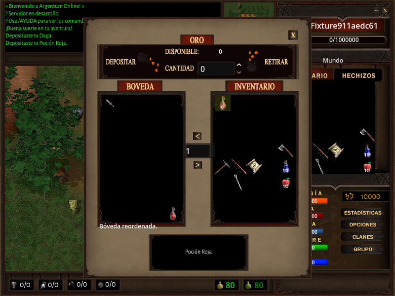
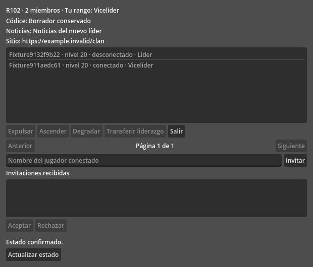
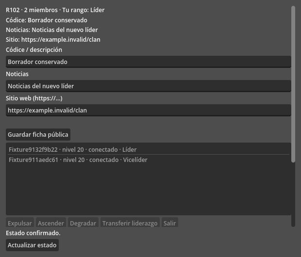

# Validación de protocolo, combate, bóveda y clan

Servidor #596, #582 y #588–#593; cliente #234/#235. Los proyectos conservan
1.0.0rc6. Se prueban fuentes; no se construyen ni publican distribuciones.

- Python: 4.166 pruebas aprobadas, cuatro casos optativos omitidos en la suite
  rápida y 80,81 % de cobertura. Ruff y mypy aprobados.
- Redis/AOF real: 29 pruebas, incluidas carreras de reordenamiento con depósito
  y extracción, reintentos, permisos y recuperación tras SIGKILL.
- Transporte: 15 casos adversos con sockets TCP, TLS y WSS reales, certificados
  verificados y el handler del servidor. Están incluidos en la suite rápida.
- Godot: suite completa, 61 escritores y 87 casos de recepción; interfaces de
  bóveda y clan, borradores, conflicto y ausencia de cambios bancarios optimistas.
- Herramientas: 56 pruebas del servidor y 156 del cliente.
- Juego: 25 recorridos gráficos con dos Godot, TLS y PulseAudio, Redis desechable,
  reinicio del servidor y reconexión. La observación final dura 60 segundos.
  Es una regresión funcional; no acredita una instalación Snap ni una aceptación
  prolongada de 30 minutos.

[Resultado original](graphical-result.json), [escenarios](graphical-scenarios.json)
y [verificación de hashes y pruebas](verification.json). Los commits anotados al
arrancar pueden preceder a commits de documentación: `verification.json` comprueba
los archivos de runtime contra los blobs Git de las revisiones implementadas,
sin reescribir la procedencia del resultado original. La ejecución final usa un
escritorio X11/Xvfb aislado, con renderizado y audio real, sin `--headless`.

La comparación de latencia y sus límites se conservan en
[el benchmark #596](../../benchmarks/combat-durability-596.json). No confundir el
RTT de PING con el ACK durable del golpe. Las instalaciones Redis existentes
necesitan configurar `appendfsync always` para eliminar la espera periódica de
`everysec`.

## Bóveda reordenada

## Consulta del miembro después de reconectar

## Edición del nuevo líder después de reconectar

