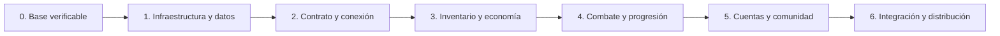

# Alcance de la versión 1.0 de ProyectoAO

Fecha de definición: **18 de octubre de 2026**. Seguimiento: [S#123].
**S** identifica `cavazquez/pyao-server`; **C**, `cavazquez/ArgentumOnlineGodot`.

La 1.0 permite instalar el cliente nativo en Linux amd64 y jugar con dos cuentas simultáneas contra un servidor Python y Redis: crear personaje, recorrer los mapas propios, conversar, gestionar los 30 slots de inventario, comerciar, combatir NPCs, usar magia, progresar y conservar los datos al reconectar o reiniciar. Mantiene party, clanes y mascotas ya existentes. El primer canal de Snap es `latest/edge`, conforme a [C#46].

Este documento fija los requisitos, el orden y las pruebas de salida. Los documentos de estado, roadmap y TODOs enlazan aquí y no amplían el alcance por su cuenta. La selección tiene **87 issues: 59 del servidor —incluido este trabajo de definición— y 28 del cliente**. Contiene los **24 P1 abiertos** del inventario del 18/10/2026. Los otros **95 issues quedan después de la 1.0**.

## Producto y compatibilidad incluidos

- **Plataforma inicial:** cliente nativo Linux amd64, construido con un Godot y export templates de la misma versión exacta, determinados en [C#10]. El servidor se ejecuta con uv, Python compatible con `pyproject.toml` y Redis persistente. El paquete del cliente no contiene servidor ni Redis.
- **Cuentas y personaje:** alta/login directos propios de pyao, cambio de contraseña, clases, razas, apariencia y las seis ciudades iniciales del proyecto. No se adopta el sistema de cuentas/hash y selección de personajes de AO Libre.
- **Mundo:** mapas, salidas, NPCs, objetos, sonidos y recursos propios versionados; transiciones y señales legibles. Los IDs del dataset se validan sin sustituirlo por el de Hide Zone.
- **Inventario y economía:** 30 slots, equipar, usar, mover, tirar y recoger; oro, banco, comercio NPC y entre jugadores conservan cantidades y saldos ante concurrencia o caída.
- **Combate y progresión:** combate PvE, muerte/resurrección, recursos y cooldowns autoritativos, magia con selección de objetivo, habilidades con puntos validados y aprendizaje mediante pergaminos. Se conserva el progreso existente al migrar.
- **Comunidad:** chat público/privado/de party/clan y las operaciones de party/clan ya implementadas, utilizables mediante sus comandos. La ventana de detalles/salida de clan funciona. Los paneles nuevos de administración y Party Finder quedan para después; no se retiran los comandos que ya funcionan.
- **Mascotas y trabajo existentes:** invocación/liberación/seguimiento actual, tala, minería y pesca se conservan y entran en la regresión del cliente real. Nuevas órdenes, domesticación y fabricación no forman parte del cierre.
- **Distribución:** servidor instalable desde wheel con sus recursos y cliente Snap `pyao-client` instalado desde `latest/edge`, con créditos, configuración de usuario persistente y pruebas desde fuera del checkout. La promoción a `stable` y otras arquitecturas/plataformas no se dan por completadas en [C#46].

El protocolo mantiene sus IDs y layouts acordados en [S#94]. Las extensiones nuevas se negocian en [S#117]; una mejora de UI de Hide Zone no puede cambiar el dialecto de red de forma implícita. El contrato prueba especialmente Logged=0, ChangeMap, strings, los 30 slots, habilidades, clan, party y lanzamiento de magia. Las acciones todavía sin backend se deshabilitan de forma explícita en [C#7].

Las reglas comunes de PvP de [S#136] sí entran como protección de las fuentes de daño existentes. El nuevo combate físico entre jugadores de [S#179] queda fuera. Una feature ausente no puede habilitarse por enviar un paquete manualmente.

## Orden de implementación

Las fases se cierran en este orden. Dentro de una fase, primero se resuelven las dependencias de cada issue; las ramas independientes pueden trabajarse en paralelo. La división mantiene todas las dependencias ya enlazadas dentro del alcance y sin dependencias hacia fases posteriores.

### Fase 0 Base verificable

El primer trabajo práctico es recuperar las comprobaciones del servidor con [S#109] y [S#110], mientras [C#10] fija e importa el proyecto con un motor mantenido. [S#143] valida el dataset propio.

**Servidor:**

- [S#123] — Definir el alcance verificable de la versión 1.0 y reconciliar el roadmap.
- [S#109] — Corregir la importación inexistente de MapManager y recuperar mypy.
- [S#110] — Aislar el bloqueo de test_data_initializer_with_real_merchant_loader.
- [S#143] — Validar referencias del dataset antes de iniciar el mundo.

**Cliente:**

- [C#10] — Fijar una versión de Godot mantenida y actualizar la guía de ejecución.

**Salida: se puede ejecutar la suite sin el bloqueo conocido, comprobar tipos y validar datos; el motor elegido importa el cliente. Se registra el resultado real de cada comando.**

### Fase 1 Infraestructura, sesión y datos

Configurar host/puerto y Redis efectivos; separar sesiones, proteger credenciales, limitar autenticación y conexiones y preparar persistencia, backup y migraciones. El cliente deja de guardar contraseñas y verifica TLS.

**Servidor:**

- [S#87] — Respetar host y puerto explícitos del CLI durante el arranque **P1**.
- [S#88] — Inyectar la configuración efectiva en la conexión y el pool Redis **P1**.
- [S#86] — Aislar los handlers con estado de sesión entre conexiones **P1**.
- [S#89] — Eliminar credenciales y payloads de autenticación de los logs del servidor **P1**.
- [S#98] — Aplicar server.max_connections al aceptar y cerrar conexiones **P1**.
- [S#99] — Ejecutar Argon2 fuera del event loop con concurrencia acotada **P1**.
- [S#100] — Limitar intentos y tiempo de autenticación por conexión, IP y cuenta **P1**.
- [S#128] — Reservar una única sesión activa por cuenta durante el login.
- [S#108] — Publicar Redis y Redis Insight solo en loopback en el Compose de desarrollo.
- [S#106] — Definir y comprobar la persistencia de Redis para datos de jugadores.
- [S#107] — Agregar un procedimiento verificable de backup y restauración de Redis.
- [S#144] — Versionar las migraciones del estado persistido en Redis.
- [S#116] — Aislar clientes lentos con colas de salida acotadas por conexión.

**Cliente:**

- [C#1] — Eliminar contraseñas de los logs de login y creación de personaje **P1**.
- [C#2] — Dejar de persistir la contraseña y migrar saved_credentials.dat **P1**.
- [C#3] — Conectar por TLS verificando certificado y nombre del servidor **P1**.
- [C#8] — Corregir la referencia maps/Map1.tscn de la creación de personaje.
- [C#11] — Ejecutar importación y exportación headless del cliente en CI Linux.

**Salida: dos autenticaciones no comparten estado; una cuenta no entra dos veces; secretos ausentes de logs/disco; Redis y configuración responden a lo configurado y un backup se restaura en una instancia descartable.**

### Fase 2 Contrato y primer recorrido

Fijar [S#94] antes de cambiar writers/readers. Continuar con [S#95] → [S#96], junto con [C#4], [S#97] y [C#5]. Tras el buffer del cliente y las migraciones se corrige [S#126]. El smoke de [S#111] permite cerrar la CI de [S#145].

**Servidor:**

- [S#94] — Fijar el contrato binario compartido y sus fixtures de compatibilidad **P1**.
- [S#95] — Alinear las longitudes de PacketFramer con los paquetes soportados **P1**.
- [S#96] — Integrar PacketFramer por conexión en el receptor TCP del servidor **P1**.
- [S#97] — Unificar a 30 el límite de slots en repositorios y validadores del servidor **P1**.
- [S#90] — Mantener el maná persistido dentro del rango int16 del protocolo **P1**.
- [S#105] — Decodificar auth, chat y party con el codec Latin-1 acordado.
- [S#103] — Leer PARTY_JOIN con el mismo layout u16 y nickname que el cliente.
- [S#104] — Procesar DOUBLE_CLICK de mapa con coordenadas x,y en el servidor.
- [S#112] — Resolver signs.toml desde la raíz correcta de datos.
- [S#126] — Alinear SEND_SKILLS y el catálogo de habilidades entre servidor y cliente **P1**.
- [S#117] — Negociar extensiones visuales sin alterar el protocolo legacy.
- [S#111] — Agregar un smoke test de dos clientes contra el servidor y Redis descartable.
- [S#145] — Ejecutar CI hermética con uv y separar integración Redis de pruebas rápidas.

**Cliente:**

- [C#4] — Conservar y reconstruir paquetes TCP incompletos en el cliente **P1**.
- [C#5] — Representar los 30 slots de inventario y validar índices recibidos **P1**.
- [C#6] — Enviar el destinatario de /PARTY con el formato acordado.
- [C#7] — Deshabilitar en la UI las operaciones que el servidor aún no soporta.
- [C#9] — Alinear los límites de usuario y contraseña de login y alta.
- [C#12] — Rechazar texto no representable en el codec sin sustituir caracteres.
- [C#14] — Acotar el intento de conexión y recuperar el formulario al fallar.

**Salida: dos clientes Godot pueden crear cuenta/entrar, ver el mapa, moverse y conversar en un entorno aislado; las fixtures resisten fragmentación y concatenación. Es un hito de integración local; la salida pública exige las fases restantes.**

### Fase 3 Inventario y economía

Completar primero [S#91], con [S#97] y [S#106] resueltos en las fases anteriores. Sobre esas bases se cierran transferencias, compras, ventas, pickups y drops. [S#130] → [S#152] preceden al panel de intercambio [C#65]. [C#22] precede a las ventanas comerciales.

**Servidor:**

- [S#91] — Hacer atómicas las mutaciones de oro del jugador **P1**.
- [S#92] — Transferir oro entre jugador y banco como una única operación atómica **P1**.
- [S#93] — Confirmar el intercambio entre jugadores con una transacción durable **P1**.
- [S#131] — Transferir ítems entre banco e inventario como una sola operación recuperable.
- [S#132] — Hacer durable la reclamación de objetos del suelo antes de acreditar inventario.
- [S#133] — Comprar al NPC con stock, oro e inventario confirmados atómicamente.
- [S#134] — Vender al NPC con entrega de objetos y crédito de oro consistentes.
- [S#153] — Confirmar conjuntamente el drop de inventario y el objeto persistido en el suelo.
- [S#130] — Sincronizar las ofertas y confirmaciones del intercambio entre jugadores.
- [S#152] — Cancelar trades al desconectar, cambiar de mapa o vencer la invitación.

**Cliente:**

- [C#22] — Unificar Escape y bloquear acciones cuando una ventana tiene foco.
- [C#16] — Portar el arrastre de inventario con MOVE_ITEM de pyao.
- [C#27] — Convertir el panel comercial en una ventana adaptable.
- [C#33] — Mostrar una acción comercial y el precio correcto de pyao.
- [C#65] — Completar el panel de intercambio entre jugadores con ofertas versionadas.

**Salida: banco, suelo, comerciantes y trades conservan el total de objetos/oro con dos jugadores, reintentos y errores de Redis; los precios visibles siguen la fórmula de pyao.**

### Fase 4 Combate, magia y progresión

Aplicar cadencias de movimiento/ataque y validar los costes antes del cooldown mágico [S#149]. [S#124] precede al targeting [C#54]; [S#126] → [S#150] → [C#61] completa habilidades. Drop durable precede a muerte idempotente y resurrección común.

**Servidor:**

- [S#101] — Imponer una cadencia autoritativa de movimiento del jugador **P1**.
- [S#102] — Imponer un cooldown autoritativo de ataque del jugador **P1**.
- [S#124] — Habilitar CAST_SPELL con coordenadas mediante un formato inequívoco.
- [S#125] — Confirmar el coste de un hechizo después de validar su ejecución.
- [S#149] — Aplicar un cooldown autoritativo al lanzamiento de hechizos **P1**.
- [S#135] — Conservar el libro aprendido sin agregar todo el catálogo en cada login.
- [S#150] — Implementar MODIFY_SKILLS con presupuesto de puntos y actualización atómica.
- [S#154] — Aprender un hechizo desde un pergamino con consumo y persistencia consistentes.
- [S#136] — Centralizar las reglas de PvP y zonas seguras para daño físico y mágico.
- [S#166] — Procesar la muerte de cada jugador una sola vez por vida.
- [S#178] — Unificar la resurrección de hechizos y NPCs en el ciclo de vida del jugador.
- [S#113] — Preservar los intervalos de hambre y sed configurados al reiniciar.

**Cliente:**

- [C#47] — Reordenar el libro sin índices inválidos ni pérdida de selección.
- [C#54] — Seleccionar el objetivo de un hechizo por clic y permitir cancelarlo.
- [C#61] — Confirmar la asignación de habilidades con el estado recibido del servidor.

**Salida: un recorrido PvE permite combatir, aprender y lanzar magia, asignar puntos, morir y revivir sin pérdida/duplicación de recursos ni estado visual anterior. Pets y trabajos existentes mantienen su comportamiento.**

### Fase 5 Cuentas, comunidad e interfaz

Cerrar [S#129] antes de [C#32] y [S#127] antes de [C#55]. Mantener comandos sociales existentes, acotar chat, restringir diagnóstico interno y separar texto recibido de acciones del cliente.

**Servidor:**

- [S#127] — Implementar cambio de contraseña autenticado con confirmación de resultado.
- [S#129] — Enviar CLAN_DETAILS desde el handler que actualmente sólo imprime por consola.
- [S#140] — Limitar mensajes de chat por jugador sin bloquear los comandos esenciales.
- [S#163] — Restringir el detalle operativo de METRICS a permisos de administración.

**Cliente:**

- [C#49] — Separar texto de chat de BBCode y acciones internas del cliente.
- [C#23] — Corregir el minimapa sin asumir el recorte de AO Libre.
- [C#53] — Evitar enviar WARP_CHAR al hacer clic normal en el minimapa.
- [C#32] — Mostrar detalles de clan con el formato y acciones de pyao.
- [C#55] — Conectar el formulario de contraseña al resultado real del servidor.

**Salida: party y clan funcionan con dos cuentas; sólo usuarios autorizados acceden a métricas; un modal o chat no ejecuta acciones del mundo y el minimapa normal no envía teletransporte GM.**

### Fase 6 Integración y distribución

Validar wheel y recursos instalados; drenar conexiones antes de cerrar Redis. Ejecutar [C#60] después de las funciones anteriores usando el export de [C#11]. Construir/publicar [C#46] después del recorrido aprobado y repetir el smoke desde el Snap instalado.

**Servidor:**

- [S#142] — Conservar nombres válidos de wheels y verificar su instalación con uv.
- [S#165] — Incluir datos de ejecución y resolver rutas desde el paquete instalado.
- [S#175] — Drenar conexiones y tareas antes de cerrar Redis durante el shutdown.

**Cliente:**

- [C#60] — Automatizar un recorrido real de Godot contra servidor y Redis aislados.
- [C#46] — Empaquetar y publicar el cliente en Snap Store como pyao-client.

**Salida: todos los requisitos observables de este documento tienen evidencia para el mismo par de revisiones; se instala y ejecuta el cliente y servidor sin depender del checkout.**

### Precedencias de release que complementan los issues

- [S#144] debe estar listo antes de persistir el nuevo modelo de habilidades de [S#126] y la política de spellbook de [S#135]. Se preserva el progreso previo y se prueba la migración con backup.
- [C#32] depende también del envío real de [S#129], además de las fixtures del reader; esta relación ya está registrada entre repositorios.
- [C#60] se aprueba después de los cambios funcionales de las fases 0 a 5 y de [S#142], [S#165] y [S#175]. Una integración temprana parcial no satisface la puerta final de release.
- [C#46] depende de [C#10] y reutiliza [C#11]. La salida pública espera además [C#1], [C#2], [C#3], [C#8] y [C#60]. La preparación del preset puede avanzar antes; la publicación sigue esas puertas.

## Requisitos y pruebas observables de salida

Las siguientes comprobaciones se ejecutan contra el **mismo par de commits**, con Redis descartable y los datos propios. Las pruebas de conservación también se ejecutan con un corte de proceso/fallo de Redis en los límites relevantes. Cada resultado registra fecha, comando, versiones, configuración, dataset y logs sin secretos. Un issue cerrado por sí solo no sustituye esta evidencia.

### R01 Construcción reproducible

Responsables: [S#109], [S#110], [S#143], [S#145], [C#10], [C#11].

Una copia limpia instala dependencias con `uv sync --locked`; lint, formato, tipos y suite completa terminan con éxito. La integración usa Redis aislado y timeouts diagnosticables. Godot y templates tienen una versión exacta común, y la importación/exportación Linux termina sin dependencias locales ocultas. No se exige una cifra histórica de tests o cobertura; se adjunta el resultado del candidato.

### R02 Identidad y transporte

Responsables: [S#86], [S#87], [S#88], [S#89], [S#98], [S#99], [S#100], [S#128], [S#127], [C#1], [C#2], [C#3], [C#9], [C#14], [C#55].

Crear dos cuentas, entrar simultáneamente y rechazar un segundo login de una misma cuenta. Cambiar una contraseña y comprobar que sólo la nueva autentica. Certificado/nombre inválidos producen rechazo visible; timeout/cancelación permite reintentar. Una contraseña canaria no aparece en logs, bytes de depuración ni preferencias guardadas. Los límites de conexión/autenticación se liberan tras error/desconexión y no bloquean el event loop.

### R03 Contrato de red y acciones soportadas

Responsables: [S#94], [S#95], [S#96], [S#105], [S#117], [C#4], [C#6], [C#7], [C#12].

Fragmentar y concatenar fixtures de los mensajes del recorrido sin desalinear el siguiente paquete. La sesión se conserva entre reads y se limpian sus buffers al cerrar. Strings acentuadas y texto no representable siguen el codec y rechazo acordados. Una extensión no se envía a un cliente legacy; las operaciones no soportadas se muestran deshabilitadas sin sustituirlas por otro ID.

### R04 Mundo y datos propios

Responsables: [S#104], [S#106], [S#107], [S#108], [S#112], [S#143], [S#144], [C#8]. Validación conjunta: [C#60].

Crear personajes mediante las seis ciudades y configuraciones admitidas, cargar mapas con las mayúsculas correctas en Linux, atravesar salidas y leer señales. Validar referencias de NPCs/objetos/recursos del dataset incluido. Reconectar, reiniciar Redis/servidor y restaurar backup en otra instancia conserva cuentas y progreso. Una migración interrumpida se recupera; Redis de desarrollo sólo se publica en loopback.

### R05 Inventario y economía

Responsables: [S#91], [S#92], [S#93], [S#97], [S#130], [S#131], [S#132], [S#133], [S#134], [S#152], [S#153], [C#5], [C#16], [C#27], [C#33], [C#65].

Usar los slots 1, 25, 26 y 30; equipar, consumir, mover, tirar y recoger. Depositar/retirar oro y objetos, comprar/vender al NPC y completar/cancelar un trade entre los dos jugadores. Precio de venta: `(valor // 2) * cantidad`. Dos compradores por la última unidad, inventario lleno, oferta vieja, desconexión y reintentos conservan el total de dinero y unidades, también tras reiniciar.

### R06 Combate, magia y progreso

Responsables: [S#90], [S#101], [S#102], [S#113], [S#124], [S#125], [S#126], [S#135], [S#136], [S#149], [S#150], [S#154], [S#166], [S#178], [C#47], [C#54], [C#61].

Combatir un NPC, recibir experiencia/loot y confirmar los cambios de nivel que correspondan; usar pociones, meditar y verificar hambre/sed configuradas. Lanzar/cancelar magia sobre objetivos válidos e inválidos, mantener maná serializable y rechazar exceso de cadencia sin cobros parciales. Asignar sólo puntos disponibles, aprender un pergamino una vez y conservar libro/orden al reconectar. Dos daños letales procesan una muerte; hechizo y NPC de resurrección restauran la misma apariencia/estado. Las restricciones de PvP y zona segura alcanzan todas las fuentes de daño existentes.

### R07 Comunidad y controles del cliente

Responsables: [S#103], [S#129], [S#140], [S#163], [C#6], [C#22], [C#23], [C#32], [C#49], [C#53]. Validación conjunta: [C#60].

Enviar chat público, privado, de party y clan; crear/invitar/aceptar/abandonar un grupo y usar los comandos de clan existentes, incluyendo detalles/salida. Revisar permisos y reparto existente de experiencia/loot. Mensajes con etiquetas falsas se muestran como texto; sólo una captura creada por el cliente conserva su acción interna. Escribir o abrir un modal impide movimiento/ataque involuntario. El clic habitual del minimapa no manda acciones GM y una cuenta común no consulta el detalle operativo de METRICS.

### R08 Conservación de funciones existentes

Responsables del recorrido: [S#111] y [C#60]; conservación del contrato: [S#94] y [C#7].

Talar, minar y pescar con las herramientas propias; invocar/liberar mascotas y observar el seguimiento actual; usar las clases, razas, cabezas, cascos, ciudades y recursos versionados. El port no elimina estos flujos ni requiere datasets, login AO Libre o plugins de desarrollo externos. Las operaciones futuras permanecen identificadas como pendientes. Un fallo observado en estas regresiones se vincula al issue responsable antes de aprobar el candidato.

### R09 Operación y distribución

Responsables: [S#116], [S#142], [S#165], [S#175], [C#46].

Instalar el wheel mediante uv en un entorno aislado y arrancar desde un directorio ajeno al repositorio. Instalar con `snap install pyao-client --edge`, abrirlo sin el editor de Godot y repetir login/mapa/chat/inventario contra el servidor candidato. La receta valida recursos dinámicos, escritorio, entrada, gráficos y audio en las sesiones declaradas soportadas. Reiniciar/actualizar conserva preferencias sin secretos; SIGTERM cierra sesiones antes de Redis y un cliente lento no detiene al resto. La publicación registra nombre, revisión y resultado de revisión de la Store; no declara registrado un nombre aún no comprobado.

### R10 Aprobación del par servidor y cliente

Responsables: [S#111], [C#60], [C#46].

Ejecutar un recorrido de al menos **30 minutos con dos clientes Godot reales** contra una instancia aislada del servidor y Redis. Automatizar el recorrido con el export nativo en [C#60] y completar el smoke del Snap instalado en [C#46]. Adjuntar evidencia de R01 a R09 para ese par de revisiones. La prueba recorre entrada, mapa, chat, inventario, economía, combate, magia, party/clan y reconexión; no se sustituye por dos scripts que sólo hablan el protocolo. Los dos clientes constituyen la aceptación mínima de multijugador, no una medición de capacidad MMO.

La 1.0 se aprueba cuando las fases están resueltas, todos los P1 del alcance están cerrados y R01 a R10 pasan para el candidato. Se publica el par de tags/commits, versión de contrato, dataset y herramientas utilizadas. Una feature nueva requiere una decisión explícita de alcance; el backlog no crece automáticamente como condición de cierre.

## Trabajo posterior a la 1.0

Quedan fuera del cierre: quests y facciones; PvP físico nuevo; diplomacia/depósito de clan; Party Finder y paneles nuevos de administración social; crafting; nuevas órdenes/domesticación de mascotas; WSS/web; efectos visuales avanzados, mapa mundial y precarga; controles/preferencias adicionales; música de mapa nueva; accesibilidad ampliada; Windows/macOS/ARM64; refactors y benchmarks sin una incidencia bloqueante del recorrido.

Los comandos y funciones que ya existen se conservan aunque su interfaz nueva quede para después. La corrección [S#136] es una excepción deliberada a su clasificación optativa original: protege las reglas del daño ya existente y por eso entra en la 1.0.

**Servidor — issues posteriores:** [S#114], [S#115], [S#118], [S#119], [S#120], [S#121], [S#122], [S#137], [S#138], [S#139], [S#141], [S#146], [S#147], [S#148], [S#151], [S#155], [S#156], [S#157], [S#158], [S#159], [S#160], [S#161], [S#162], [S#164], [S#167], [S#168], [S#169], [S#170], [S#171], [S#172], [S#173], [S#174], [S#176], [S#177], [S#179], [S#180], [S#181], [S#182], [S#183], [S#184], [S#185].

**Cliente — issues posteriores:** [C#13], [C#15], [C#17], [C#18], [C#19], [C#20], [C#21], [C#24], [C#25], [C#26], [C#28], [C#29], [C#30], [C#31], [C#34], [C#35], [C#36], [C#37], [C#38], [C#39], [C#40], [C#41], [C#42], [C#43], [C#44], [C#45], [C#48], [C#50], [C#51], [C#52], [C#56], [C#57], [C#58], [C#59], [C#62], [C#63], [C#64], [C#66], [C#67], [C#68], [C#69], [C#70], [C#71], [C#72], [C#73], [C#74], [C#75], [C#76], [C#77], [C#78], [C#79], [C#80], [C#81], [C#82].

## Estado observado y trazabilidad

El 18/10/2026 se inspeccionaron servidor `8204c732e517b598f14ce89a2983934c12fa2e39` y cliente `5e6181e88f42e8b13c2328d5a958cff017f58071`. `pyproject.toml` declara **0.10.0-alpha** y `project.godot`, **4.5 / GL Compatibility**. Esa declaración del proyecto no sustituye la selección y validación del motor en [C#10]. Este trabajo documental no cambia las versiones ni implementa los issues de runtime.

El inventario leído en esa fecha contiene 100 issues abiertos de servidor y 82 de cliente. El alcance selecciona 87, incluidos los 24 P1; el grafo de dependencias de la selección está completo y sin ciclos. Las precedencias adicionales de release indicadas arriba forman parte del orden, aunque no todas sean relaciones nativas de GitHub.

Los problemas conocidos de tipos y bloqueo de suite se siguen en [S#109] y [S#110]. El resultado de una suite anterior, una cantidad de tests o una cobertura histórica no acredita la calidad del candidato 1.0. La evidencia de aprobación se obtiene en R01 a R10 y se fecha junto al par de revisiones probado.

El ajuste local de Snap multiplataforma del servidor sigue preservado y tiene su propio issue [S#119]; no se reaplica ni se elimina como parte de esta definición. La 1.0 inicial distribuye el servidor con uv/wheel y no exige validar las cuatro arquitecturas de ese ajuste.

[C#1]: https://github.com/cavazquez/ArgentumOnlineGodot/issues/1
[C#2]: https://github.com/cavazquez/ArgentumOnlineGodot/issues/2
[C#3]: https://github.com/cavazquez/ArgentumOnlineGodot/issues/3
[C#4]: https://github.com/cavazquez/ArgentumOnlineGodot/issues/4
[C#5]: https://github.com/cavazquez/ArgentumOnlineGodot/issues/5
[C#6]: https://github.com/cavazquez/ArgentumOnlineGodot/issues/6
[C#7]: https://github.com/cavazquez/ArgentumOnlineGodot/issues/7
[C#8]: https://github.com/cavazquez/ArgentumOnlineGodot/issues/8
[C#9]: https://github.com/cavazquez/ArgentumOnlineGodot/issues/9
[C#10]: https://github.com/cavazquez/ArgentumOnlineGodot/issues/10
[C#11]: https://github.com/cavazquez/ArgentumOnlineGodot/issues/11
[C#12]: https://github.com/cavazquez/ArgentumOnlineGodot/issues/12
[C#13]: https://github.com/cavazquez/ArgentumOnlineGodot/issues/13
[C#14]: https://github.com/cavazquez/ArgentumOnlineGodot/issues/14
[C#15]: https://github.com/cavazquez/ArgentumOnlineGodot/issues/15
[C#16]: https://github.com/cavazquez/ArgentumOnlineGodot/issues/16
[C#17]: https://github.com/cavazquez/ArgentumOnlineGodot/issues/17
[C#18]: https://github.com/cavazquez/ArgentumOnlineGodot/issues/18
[C#19]: https://github.com/cavazquez/ArgentumOnlineGodot/issues/19
[C#20]: https://github.com/cavazquez/ArgentumOnlineGodot/issues/20
[C#21]: https://github.com/cavazquez/ArgentumOnlineGodot/issues/21
[C#22]: https://github.com/cavazquez/ArgentumOnlineGodot/issues/22
[C#23]: https://github.com/cavazquez/ArgentumOnlineGodot/issues/23
[C#24]: https://github.com/cavazquez/ArgentumOnlineGodot/issues/24
[C#25]: https://github.com/cavazquez/ArgentumOnlineGodot/issues/25
[C#26]: https://github.com/cavazquez/ArgentumOnlineGodot/issues/26
[C#27]: https://github.com/cavazquez/ArgentumOnlineGodot/issues/27
[C#28]: https://github.com/cavazquez/ArgentumOnlineGodot/issues/28
[C#29]: https://github.com/cavazquez/ArgentumOnlineGodot/issues/29
[C#30]: https://github.com/cavazquez/ArgentumOnlineGodot/issues/30
[C#31]: https://github.com/cavazquez/ArgentumOnlineGodot/issues/31
[C#32]: https://github.com/cavazquez/ArgentumOnlineGodot/issues/32
[C#33]: https://github.com/cavazquez/ArgentumOnlineGodot/issues/33
[C#34]: https://github.com/cavazquez/ArgentumOnlineGodot/issues/34
[C#35]: https://github.com/cavazquez/ArgentumOnlineGodot/issues/35
[C#36]: https://github.com/cavazquez/ArgentumOnlineGodot/issues/36
[C#37]: https://github.com/cavazquez/ArgentumOnlineGodot/issues/37
[C#38]: https://github.com/cavazquez/ArgentumOnlineGodot/issues/38
[C#39]: https://github.com/cavazquez/ArgentumOnlineGodot/issues/39
[C#40]: https://github.com/cavazquez/ArgentumOnlineGodot/issues/40
[C#41]: https://github.com/cavazquez/ArgentumOnlineGodot/issues/41
[C#42]: https://github.com/cavazquez/ArgentumOnlineGodot/issues/42
[C#43]: https://github.com/cavazquez/ArgentumOnlineGodot/issues/43
[C#44]: https://github.com/cavazquez/ArgentumOnlineGodot/issues/44
[C#45]: https://github.com/cavazquez/ArgentumOnlineGodot/issues/45
[C#46]: https://github.com/cavazquez/ArgentumOnlineGodot/issues/46
[C#47]: https://github.com/cavazquez/ArgentumOnlineGodot/issues/47
[C#48]: https://github.com/cavazquez/ArgentumOnlineGodot/issues/48
[C#49]: https://github.com/cavazquez/ArgentumOnlineGodot/issues/49
[C#50]: https://github.com/cavazquez/ArgentumOnlineGodot/issues/50
[C#51]: https://github.com/cavazquez/ArgentumOnlineGodot/issues/51
[C#52]: https://github.com/cavazquez/ArgentumOnlineGodot/issues/52
[C#53]: https://github.com/cavazquez/ArgentumOnlineGodot/issues/53
[C#54]: https://github.com/cavazquez/ArgentumOnlineGodot/issues/54
[C#55]: https://github.com/cavazquez/ArgentumOnlineGodot/issues/55
[C#56]: https://github.com/cavazquez/ArgentumOnlineGodot/issues/56
[C#57]: https://github.com/cavazquez/ArgentumOnlineGodot/issues/57
[C#58]: https://github.com/cavazquez/ArgentumOnlineGodot/issues/58
[C#59]: https://github.com/cavazquez/ArgentumOnlineGodot/issues/59
[C#60]: https://github.com/cavazquez/ArgentumOnlineGodot/issues/60
[C#61]: https://github.com/cavazquez/ArgentumOnlineGodot/issues/61
[C#62]: https://github.com/cavazquez/ArgentumOnlineGodot/issues/62
[C#63]: https://github.com/cavazquez/ArgentumOnlineGodot/issues/63
[C#64]: https://github.com/cavazquez/ArgentumOnlineGodot/issues/64
[C#65]: https://github.com/cavazquez/ArgentumOnlineGodot/issues/65
[C#66]: https://github.com/cavazquez/ArgentumOnlineGodot/issues/66
[C#67]: https://github.com/cavazquez/ArgentumOnlineGodot/issues/67
[C#68]: https://github.com/cavazquez/ArgentumOnlineGodot/issues/68
[C#69]: https://github.com/cavazquez/ArgentumOnlineGodot/issues/69
[C#70]: https://github.com/cavazquez/ArgentumOnlineGodot/issues/70
[C#71]: https://github.com/cavazquez/ArgentumOnlineGodot/issues/71
[C#72]: https://github.com/cavazquez/ArgentumOnlineGodot/issues/72
[C#73]: https://github.com/cavazquez/ArgentumOnlineGodot/issues/73
[C#74]: https://github.com/cavazquez/ArgentumOnlineGodot/issues/74
[C#75]: https://github.com/cavazquez/ArgentumOnlineGodot/issues/75
[C#76]: https://github.com/cavazquez/ArgentumOnlineGodot/issues/76
[C#77]: https://github.com/cavazquez/ArgentumOnlineGodot/issues/77
[C#78]: https://github.com/cavazquez/ArgentumOnlineGodot/issues/78
[C#79]: https://github.com/cavazquez/ArgentumOnlineGodot/issues/79
[C#80]: https://github.com/cavazquez/ArgentumOnlineGodot/issues/80
[C#81]: https://github.com/cavazquez/ArgentumOnlineGodot/issues/81
[C#82]: https://github.com/cavazquez/ArgentumOnlineGodot/issues/82
[S#86]: https://github.com/cavazquez/pyao-server/issues/86
[S#87]: https://github.com/cavazquez/pyao-server/issues/87
[S#88]: https://github.com/cavazquez/pyao-server/issues/88
[S#89]: https://github.com/cavazquez/pyao-server/issues/89
[S#90]: https://github.com/cavazquez/pyao-server/issues/90
[S#91]: https://github.com/cavazquez/pyao-server/issues/91
[S#92]: https://github.com/cavazquez/pyao-server/issues/92
[S#93]: https://github.com/cavazquez/pyao-server/issues/93
[S#94]: https://github.com/cavazquez/pyao-server/issues/94
[S#95]: https://github.com/cavazquez/pyao-server/issues/95
[S#96]: https://github.com/cavazquez/pyao-server/issues/96
[S#97]: https://github.com/cavazquez/pyao-server/issues/97
[S#98]: https://github.com/cavazquez/pyao-server/issues/98
[S#99]: https://github.com/cavazquez/pyao-server/issues/99
[S#100]: https://github.com/cavazquez/pyao-server/issues/100
[S#101]: https://github.com/cavazquez/pyao-server/issues/101
[S#102]: https://github.com/cavazquez/pyao-server/issues/102
[S#103]: https://github.com/cavazquez/pyao-server/issues/103
[S#104]: https://github.com/cavazquez/pyao-server/issues/104
[S#105]: https://github.com/cavazquez/pyao-server/issues/105
[S#106]: https://github.com/cavazquez/pyao-server/issues/106
[S#107]: https://github.com/cavazquez/pyao-server/issues/107
[S#108]: https://github.com/cavazquez/pyao-server/issues/108
[S#109]: https://github.com/cavazquez/pyao-server/issues/109
[S#110]: https://github.com/cavazquez/pyao-server/issues/110
[S#111]: https://github.com/cavazquez/pyao-server/issues/111
[S#112]: https://github.com/cavazquez/pyao-server/issues/112
[S#113]: https://github.com/cavazquez/pyao-server/issues/113
[S#114]: https://github.com/cavazquez/pyao-server/issues/114
[S#115]: https://github.com/cavazquez/pyao-server/issues/115
[S#116]: https://github.com/cavazquez/pyao-server/issues/116
[S#117]: https://github.com/cavazquez/pyao-server/issues/117
[S#118]: https://github.com/cavazquez/pyao-server/issues/118
[S#119]: https://github.com/cavazquez/pyao-server/issues/119
[S#120]: https://github.com/cavazquez/pyao-server/issues/120
[S#121]: https://github.com/cavazquez/pyao-server/issues/121
[S#122]: https://github.com/cavazquez/pyao-server/issues/122
[S#123]: https://github.com/cavazquez/pyao-server/issues/123
[S#124]: https://github.com/cavazquez/pyao-server/issues/124
[S#125]: https://github.com/cavazquez/pyao-server/issues/125
[S#126]: https://github.com/cavazquez/pyao-server/issues/126
[S#127]: https://github.com/cavazquez/pyao-server/issues/127
[S#128]: https://github.com/cavazquez/pyao-server/issues/128
[S#129]: https://github.com/cavazquez/pyao-server/issues/129
[S#130]: https://github.com/cavazquez/pyao-server/issues/130
[S#131]: https://github.com/cavazquez/pyao-server/issues/131
[S#132]: https://github.com/cavazquez/pyao-server/issues/132
[S#133]: https://github.com/cavazquez/pyao-server/issues/133
[S#134]: https://github.com/cavazquez/pyao-server/issues/134
[S#135]: https://github.com/cavazquez/pyao-server/issues/135
[S#136]: https://github.com/cavazquez/pyao-server/issues/136
[S#137]: https://github.com/cavazquez/pyao-server/issues/137
[S#138]: https://github.com/cavazquez/pyao-server/issues/138
[S#139]: https://github.com/cavazquez/pyao-server/issues/139
[S#140]: https://github.com/cavazquez/pyao-server/issues/140
[S#141]: https://github.com/cavazquez/pyao-server/issues/141
[S#142]: https://github.com/cavazquez/pyao-server/issues/142
[S#143]: https://github.com/cavazquez/pyao-server/issues/143
[S#144]: https://github.com/cavazquez/pyao-server/issues/144
[S#145]: https://github.com/cavazquez/pyao-server/issues/145
[S#146]: https://github.com/cavazquez/pyao-server/issues/146
[S#147]: https://github.com/cavazquez/pyao-server/issues/147
[S#148]: https://github.com/cavazquez/pyao-server/issues/148
[S#149]: https://github.com/cavazquez/pyao-server/issues/149
[S#150]: https://github.com/cavazquez/pyao-server/issues/150
[S#151]: https://github.com/cavazquez/pyao-server/issues/151
[S#152]: https://github.com/cavazquez/pyao-server/issues/152
[S#153]: https://github.com/cavazquez/pyao-server/issues/153
[S#154]: https://github.com/cavazquez/pyao-server/issues/154
[S#155]: https://github.com/cavazquez/pyao-server/issues/155
[S#156]: https://github.com/cavazquez/pyao-server/issues/156
[S#157]: https://github.com/cavazquez/pyao-server/issues/157
[S#158]: https://github.com/cavazquez/pyao-server/issues/158
[S#159]: https://github.com/cavazquez/pyao-server/issues/159
[S#160]: https://github.com/cavazquez/pyao-server/issues/160
[S#161]: https://github.com/cavazquez/pyao-server/issues/161
[S#162]: https://github.com/cavazquez/pyao-server/issues/162
[S#163]: https://github.com/cavazquez/pyao-server/issues/163
[S#164]: https://github.com/cavazquez/pyao-server/issues/164
[S#165]: https://github.com/cavazquez/pyao-server/issues/165
[S#166]: https://github.com/cavazquez/pyao-server/issues/166
[S#167]: https://github.com/cavazquez/pyao-server/issues/167
[S#168]: https://github.com/cavazquez/pyao-server/issues/168
[S#169]: https://github.com/cavazquez/pyao-server/issues/169
[S#170]: https://github.com/cavazquez/pyao-server/issues/170
[S#171]: https://github.com/cavazquez/pyao-server/issues/171
[S#172]: https://github.com/cavazquez/pyao-server/issues/172
[S#173]: https://github.com/cavazquez/pyao-server/issues/173
[S#174]: https://github.com/cavazquez/pyao-server/issues/174
[S#175]: https://github.com/cavazquez/pyao-server/issues/175
[S#176]: https://github.com/cavazquez/pyao-server/issues/176
[S#177]: https://github.com/cavazquez/pyao-server/issues/177
[S#178]: https://github.com/cavazquez/pyao-server/issues/178
[S#179]: https://github.com/cavazquez/pyao-server/issues/179
[S#180]: https://github.com/cavazquez/pyao-server/issues/180
[S#181]: https://github.com/cavazquez/pyao-server/issues/181
[S#182]: https://github.com/cavazquez/pyao-server/issues/182
[S#183]: https://github.com/cavazquez/pyao-server/issues/183
[S#184]: https://github.com/cavazquez/pyao-server/issues/184
[S#185]: https://github.com/cavazquez/pyao-server/issues/185
